# Autonomous Developer Search Gap Radar: Master Architectural Blueprint (v3.0 Cutting-Edge)

> **Document Status:** Approved & Production-Ready  
> **Target Environments:** Local macOS (M1/M2/M3 Silicon), GitHub Actions (.github/workflows), and Cloud Telemetry Runners  
> **Budget Constraint:** **$0.00 Hard Rule** (Zero paid APIs, zero paid hosting, zero paid proxies). Everything operates on free official developer APIs, local execution, and open-source tooling.

---

## 1. Executive Summary & Core Mission

### The Core Problem
Traditional SEO keyword tools rely on flawed, backwards-looking domain authority algorithms ("Keyword Difficulty") and artificial keyword templates (e.g., forcing `"alternative to X"`), while commercial SERP APIs cost $50–$500/month or trigger instant IP bans.

### The Radar Solution
An autonomous 24/7 intelligence engine designed specifically for developers and indie hackers that:
1. **Mines Real, Surging Demand:** Leverages the **Google Trends 8-Term Batch Comparison Engine** to harvest raw **Top** and **Rising (BREAKOUT >5,000%)** queries in sub-4 seconds without rate limits.
2. **Shields Against Unwinnable Competition:** Automatically eliminates official institutions (`.gov`, `.edu`, `.mil`) and primary brand navigational pages (`brand.com/login`, `/careers`, etc.).
3. **Audits Live SERPs with a Dual-Evidence Sieve:**
   * **Web SERP Screen:** Zero-cost DuckDuckGo HTML parser measuring exact `<title>` match voids, root domain mismatches, and stale content.
   * **Developer Evidence APIs:** Official Stack Exchange API (unresolved questions), GitHub Search API (open issues vs repos), and Hacker News Algolia API.
4. **Targets Only 4 Developable Archetypes:** Surfacing only queries where a developer can realistically build and monetize a **Micro-Tool**, a **Technical Workaround / Bug Fix**, a **Developer Recipe / Boilerplate**, or a **Breaking Tech Briefing**.
5. **Modern Localhost / LAN Dashboard:** Served on `http://localhost:8080` (and `http://192.168.100.75:8080` over LAN) with a reactive Tailwind UI, live 1-click Google verification links, daily Markdown product briefs, and full admin controls.

---

## 2. End-to-End System Architecture

```mermaid
flowchart TD
    subgraph S1["1. Trends Velocity & Breakout Ingestion"]
        A["Niche Seed Batches (8 terms per batch)<br/>e.g. docker, supabase, ollama, tailwind, etc."]
        B["google-trends-batch.js (Playwright Engine)<br/>• URL Scheme: %2C separator + %2520 space double-encoding<br/>• Blueprint B: In-Session API fallback with 350-500ms jitter<br/>• Runs on GitHub Actions (.github/workflows) OR Local Mac"]
    end

    subgraph S2["2. Raw Related Query Queue"]
        C["150–300 Real Organic Queries per Batch<br/><i>(100% verified user search volume; zero synthetic guessing)</i>"]
    end

    subgraph S3["3. Authority & Navigational Exclusion Shield"]
        D{"Is it Institutional or Primary Brand?<br/>• .gov / .edu / .mil domains<br/>• Brand login, portal, careers, support, pricing"}
        E["❌ Auto-Discard: Don't compete with official owners"]
        F["✅ Pass: Open User Intent"]
    end

    subgraph S4["4. Dual-Evidence SERP & Developer Sieve"]
        G1["<b>Layer 4A: Web SERP Screen (DuckDuckGo HTML)</b><br/>• Exact &lt;title&gt; match count (0 or 1 = Void)<br/>• Root domain / homepage ranking for deep query<br/>• Stale content (&gt;2 years old in fast tech)"]
        G2["<b>Layer 4B: Developer Evidence APIs (Free)</b><br/>• Stack Exchange API: Open, unaccepted questions<br/>• GitHub Search API: Open bug issues vs repos<br/>• Hacker News Algolia: Unmet sentiment discussions"]
    end

    subgraph S5["5. Mathematical Scoring & Archetype Classification"]
        H["Composite Opportunity Score (0 to 100)"]
        I["Map to 4 Actionable Developer Deliverables:<br/>1. Micro-Tool / Web Utility<br/>2. Detailed Workaround / Bug Fix<br/>3. Developer Recipe / Boilerplate / Cheatsheet<br/>4. Breaking Tech News / Migration Guide"]
    end

    subgraph S6["6. Storage, Dashboard & Reports Viewer"]
        J["SQLite Database (storage/niche_gaps.db)"]
        K["Localhost & LAN Dashboard (http://localhost:8080)<br/>FastAPI + Tailwind CSS + Alpine.js"]
        L["Daily Actionable Product Briefs (/reports/YYYY-MM-DD.md)"]
    end

    S1 --> S2
    S2 --> S3
    D -- Yes --> E
    D -- No --> F
    F --> S4
    S4 --> S5
    S5 --> S6
```



---

## 3. Deep Component Specifications

### Component 1: Google Trends 8-Batch Comparison Engine
* **Protocol:** Modern `TrendsUi` multiplexed endpoint with Blueprint B cloud fallback.
* **URL Encoding Rules:**
  * Term delimiter: `%2C`
  * Multi-word space double-encoding: `%2520` (e.g. `memory%2520leak`)
  * Timeframes: `now 1-h`, `now 4-h`, `now 1-d`
  * URL: `https://trends.google.com/explore?q=docker%2Ckubernetes%2Csupabase%2Collama%2Cpostgres%2Credis%2Ctailwind%2Cfastapi&date=now%201-d`
* **Cloud & Headless Runner Resilience (Blueprint B):**
  * When running on GitHub Actions or cloud VMs without cookies, uses the in-session Classic API fallback (`/trends/api/explore`) with **350–500ms anti-429 jitter**.
  * Delivers **8x request reduction** and extracts all Top and Rising (Breakout) queries in **under 4 seconds**.

---

### Component 2: Authority & Navigational Exclusion Shield
Automatically eliminates queries where Google naturally prefers official entities:
1. **Institutional Domains:** Any query where `.gov`, `.edu`, `.mil`, or official standards bodies rank in positions 1–3 is dropped.
2. **Navigational Brand Tokens:** Drops queries containing `login`, `signin`, `portal`, `careers`, `support number`, `official website`, `terms of service`, `pricing`.
3. **Primary Vendor Canonical Match:** If the primary vendor (e.g. `Stripe`) already has an exact documentation page ranking #1, it is excluded so you never build redundant clones.

---

### Component 3: Dual-Evidence SERP & Developer Sieve

#### Layer 3A: Web SERP Screen (DuckDuckGo HTML Endpoint)
* **Cost:** $0.00 (Zero API keys, zero token fees, zero CAPTCHA walls).
* **Checks:**
  * **Exact `<title>` Match Count:** How many of top 10 results have the exact phrase in `<title>`? (0/10 = untouched void, 1/10 = vulnerable, $\ge 4/10$ = saturated).
  * **Root Domain Mismatch:** If a naked domain (`https://brand.com/`) ranks for a specific 5-word technical query, Google has no dedicated article.
  * **Content Freshness:** Are top results dated 2+ years ago in fast-moving tech?

#### Layer 3B: Developer Evidence APIs (Official Free Tiers)
* **Stack Exchange API (`/search/advanced`):** Checks for open, unaccepted questions for the query's core tokens. High count = active developer pain.
* **GitHub Search API:** Counts open bug/feature issues vs existing repositories. If 40 open issues exist with 0 repo solutions = instant micro-tool gap.
* **Hacker News Algolia API:** Searches developer sentiment and discussions (100% free, unmetered).

---

### Component 4: Mathematical Scoring Algorithm (0 to 100)

$$\text{Final Gap Score} = S_{\text{SERP Vulnerability}} (0\text{--}40) + S_{\text{Dev Evidence}} (0\text{--}30) + S_{\text{Trend Velocity}} (0\text{--}30)$$

```text
[1. SERP Vulnerability Points - Max 40 pts]
  +25 pts : Exactly 0 competitors have query in <title>
  +18 pts : Exactly 1 competitor has query in <title>
  +10 pts : Root domain (homepage) ranking in Top 5 for deep query
  +05 pts : Top ranking guide is >2 years old (obsolete code)

[2. Developer Evidence Points - Max 30 pts]
  +20 pts : Active open GitHub issues with 0 existing repo solutions
  +15 pts : Multiple unresolved / unaccepted questions on Stack Overflow
  +10 pts : Active discussions on Hacker News Algolia with high comment volume

[3. Trend Velocity Points - Max 30 pts]
  +30 pts : Query marked "BREAKOUT" (>5,000% velocity surge in Google Trends)
  +20 pts : Rising query (+300% to +4,900% surge)
  +10 pts : Rising query (+100% to +299% surge)
  +05 pts : Top Query (established stable volume)
```

#### Qualification Thresholds:
* **85 – 100 (💎 Critical Gold Mine):** Surging demand with pure forum/issue rankings and zero targeted titles. Build immediately.
* **65 – 84 (⚡ High Opportunity):** Steady volume with clear competitor voids. Highly viable.
* **< 65 (Pass / Discard):** Adequately served by existing websites.

---

### Component 5: The 4 Developable Intent Archetypes

Every qualified opportunity is classified into one of 4 actionable developer deliverables:

1. **Archetype 1: Micro-Tools & Web Utilities**
   * *Triggers:* `calculator, converter, generator, viewer, validator, formatter, tester, playground, diff, visualizer`
   * *Deliverable:* Single-page responsive React/Tailwind web tool with programmatic SEO.
2. **Archetype 2: Detailed Technical Workarounds & Bug Fixes**
   * *Triggers:* `how to fix, error, failed to, cannot resolve, loop, bypass, patch, mismatch, unexpected`
   * *Deliverable:* Definitive troubleshooting guide with verified code snippets and patch scripts.
3. **Archetype 3: Developer Recipes, Boilerplates & Cheatsheets**
   * *Triggers:* `boilerplate, starter, template, cheatsheet, best practices, docker compose for, config for, example`
   * *Deliverable:* GitHub starter repository, 1-click template, or interactive reference cheatsheet.
4. **Archetype 4: Breaking Tech News & Changelog Breakdowns**
   * *Triggers:* `release date, what is new, breaking changes, migration from, deprecation, roadmap`
   * *Deliverable:* Rapid technical migration brief published within hours of the trend surge.

---

## 4. Localhost & LAN Hosting Architecture

### Access URLs:
* **Localhost:** `http://localhost:8080`
* **LAN Access (Mobile / Other Laptops):** `http://192.168.100.75:8080`

### Full-Stack Architecture:
* **Backend:** Python (FastAPI + Uvicorn) — high-speed async server querying SQLite.
* **Frontend:** Tailwind CSS + Alpine.js — clean, modern, reactive single-page app served directly with zero Node/npm build steps.
* **Database:** SQLite (`storage/niche_gaps.db`) with WAL mode for concurrent read/writes.

### Dashboard Modules:
1. **💎 Live Gold Mine Radar:** Real-time feed of opportunities sorted by score. Each card features:
   * Search velocity badge (`🔥 BREAKOUT +4,200%`)
   * Archetype tag (`Micro-Tool`, `Workaround`, `Recipe`)
   * **1-Click Google Verification Button:** Opens `https://www.google.com/search?q=<query>` in a new tab.
   * **Decision Action Buttons:** `[✅ Confirm Gold]` | `[❌ Reject / Saturated]`.
2. **📊 Full Data Explorer:** Searchable, filterable table of all processed queries with 1-click **Export to CSV / JSON**.
3. **📄 Daily Reports Viewer:** Renders daily generated Markdown briefs (`/reports/YYYY-MM-DD-goldmines.md`) with copyable developer starter code.
4. **⚙️ Admin Control Panel:**
   * Live daemon status (Running, Idle, Sleeping).
   * **"Run Scan Now"** button to trigger instant analysis on custom seeds.
   * Category selector (DevOps, AI/LLMs, Cloud, Databases, Frameworks, APIs).
   * Live streaming execution logs.

---

## 5. Storage Schema (SQLite: `storage/niche_gaps.db`)

```sql
CREATE TABLE IF NOT EXISTS queries (
    id INTEGER PRIMARY KEY AUTOINCREMENT,
    keyword TEXT UNIQUE NOT NULL,
    category TEXT NOT NULL,
    trend_type TEXT NOT NULL,          -- 'BREAKOUT', 'RISING', 'TOP'
    trend_velocity TEXT,               -- e.g. '+3,200%', 'Breakout'
    gap_score INTEGER NOT NULL,        -- 0 to 100
    archetype TEXT NOT NULL,           -- 'Tool', 'Workaround', 'Recipe', 'News'
    exact_title_matches INTEGER,       -- Count of top 10 with exact query
    has_github_issues BOOLEAN,
    has_stack_questions BOOLEAN,
    top_competitor_title TEXT,
    top_competitor_url TEXT,
    human_verdict TEXT DEFAULT 'pending', -- 'confirmed_gold', 'already_served', 'pending'
    first_seen TIMESTAMP DEFAULT CURRENT_TIMESTAMP,
    last_updated TIMESTAMP DEFAULT CURRENT_TIMESTAMP
);

CREATE INDEX IF NOT EXISTS idx_gap_score ON queries(gap_score DESC);
CREATE INDEX IF NOT EXISTS idx_archetype ON queries(archetype);
CREATE INDEX IF NOT EXISTS idx_verdict ON queries(human_verdict);
```

---

## 6. Directory Layout & File Map

```text
/Users/shrikant/Documents/Apps/General/
├── engines/
│   ├── trends_batch.js          # Playwright 8-term batch engine (Blueprint B fallback)
│   ├── exclusion_shield.py      # Drops .gov, .edu, and brand navigational queries
│   ├── serp_sieve.py            # Free DuckDuckGo HTML SERP auditor
│   ├── dev_evidence.py          # Stack Exchange & GitHub Search API collectors
│   └── scorer.py                # Mathematical scoring & archetype classifier
├── config/
│   └── dev_niches.json          # Curated batches of 8 developer terms across 10 categories
├── storage/
│   ├── db.py                    # SQLite connection & query helpers
│   └── niche_gaps.db            # Persistent database
├── reports/
│   └── YYYY-MM-DD-goldmines.md  # Daily generated actionable briefs
├── ui/
│   ├── templates/
│   │   └── index.html           # Reactive Tailwind + Alpine.js dashboard
│   └── static/
│       └── app.js               # Dashboard interactions & API calls
├── .github/
│   └── workflows/
│       └── radar.yml            # Scheduled GitHub Actions cron runner (2,000 free min/mo)
├── dashboard.py                 # FastAPI server (serves localhost:8080 & LAN)
├── radar_daemon.py              # 24/7 background worker loop
├── run_dashboard.sh             # 1-click dashboard startup script
└── run_radar.sh                 # 1-click background radar startup script
```

---

## 7. Step-by-Step Implementation Roadmap

1. **Step 1: Workspace Skeleton & Database Initialization**
   * Create all folders and initialize `storage/niche_gaps.db` with the schema.
2. **Step 2: Trends Batch Explorer (`engines/trends_batch.js`)**
   * Place the 8-term batch engine with Blueprint B cloud runner resilience.
3. **Step 3: Exclusion Shield & Dual-Evidence SERP Sieve**
   * Build `engines/exclusion_shield.py`, `engines/serp_sieve.py`, and `engines/dev_evidence.py`.
4. **Step 4: Scoring & Archetype Classification**
   * Implement `engines/scorer.py` mapping scores (0–100) to the 4 developable archetypes.
5. **Step 5: Localhost & LAN Dashboard Server (`dashboard.py`)**
   * Build the FastAPI web app with Tailwind UI on `http://localhost:8080`.
6. **Step 6: Autonomous Daemon & 1-Click Launchers**
   * Create `radar_daemon.py`, `run_radar.sh`, and `run_dashboard.sh`.
